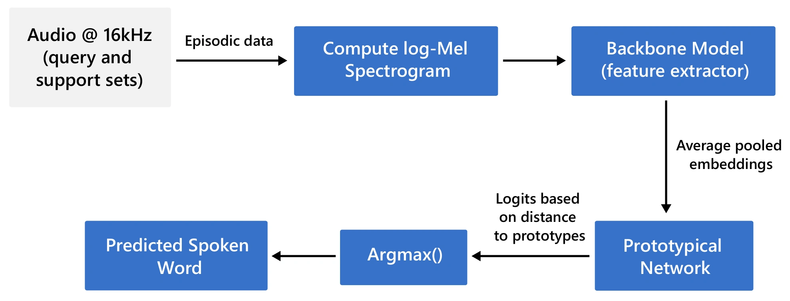

# PLiX

**Plug-and-Play Multilingual Few-shot Spoken Words Recognition**

Aaqib Saeed · Vasileios Tsouvalas · arXiv:2305.03058 2023

[ Paper](https://arxiv.org/abs/2305.03058) · [ Models](https://huggingface.co/aaqibsaeed/plixkws) · [ Project](https://nousphera.github.io/PLiX/) · [Poster](https://nousphera.github.io/PLiX/poster.pdf)

<p align="center">
  <a href="https://nousphera.github.io/PLiX/#overview"></a>
</p>
<p align="center"><sub>Figure 2 · public preprint, p. 4. <a href="https://arxiv.org/pdf/2305.03058#page=4">Original figure</a> · <a href="https://nousphera.github.io/PLiX/#overview">Animated method overview</a></sub></p>

## Abstract

As technology advances and digital devices become prevalent, seamless human-machine communication is increasingly gaining significance. The growing adoption of mobile, wearable, and other Internet of Things (IoT) devices has changed how we interact with these smart devices, making accurate spoken words recognition a crucial component for effective interaction. However, building robust spoken words detection system that can handle novel keywords remains challenging, especially for low-resource languages with limited training data. Here, we propose PLiX, a multilingual and plug-and-play keyword spotting system that leverages few-shot learning to harness massive real-world data and enable the recognition of unseen spoken words at test-time. Our few-shot deep models are learned with millions of one-second audio clips across 20 languages, achieving state-of-the-art performance while being highly efficient. Extensive evaluations show that PLiX can generalize to novel spoken words given as few as just one support example and performs well on unseen languages out of the box. We release models and inference code to serve as a foundation for future research and voice-enabled user interface development for emerging devices.

## Requirements and installation

The released inference implementation is the authors’
[plixkws package](https://pypi.org/project/plixkws/) and
[Hugging Face models](https://huggingface.co/aaqibsaeed/plixkws).
This repository provides documentation and research materials.

Use a dedicated Python 3.11 environment. The following combination was tested
on macOS arm64 CPU:

```bash
git clone https://github.com/Nousphera/PLiX.git
cd PLiX
python3.11 -m venv .venv
source .venv/bin/activate
python -m pip install --upgrade pip
python -m pip install -r requirements.txt
python -m pip check
```

[requirements.txt](requirements.txt) installs the upstream package and its direct
model/audio dependencies. Choose compatible CPU or CUDA builds of the listed
PyTorch packages for your platform.

## Pretrained models

Download the multilingual base model from the authors’ pinned Hugging Face
revision into the package’s model cache:

```bash
mkdir -p models
curl --fail --location \
  https://huggingface.co/aaqibsaeed/plixkws/resolve/80e18934275fc14ced9cde742949c00c5928be26/config.json \
  --output models/config.json
curl --fail --location \
  https://huggingface.co/aaqibsaeed/plixkws/resolve/80e18934275fc14ced9cde742949c00c5928be26/base_multi_model.pt \
  --output models/base_multi_model.pt
python - <<'PY_CHECK'
from hashlib import sha256
from pathlib import Path
actual = sha256(Path("models/base_multi_model.pt").read_bytes()).hexdigest()
assert actual == "ed7298544e7fa5e5966ce193ba2519b12714311231c15313a7e096632fa9ac80", actual
print("Checkpoint verified")
PY_CHECK
```

The pinned repository also contains the English base encoder and
language-specific small encoders. Select matching `encoder_name` and `language`
values as described in the [model guide](docs/IMPLEMENTATION.md#package-and-models).
The base model uses EfficientNet-v2 Medium; the small model uses TinyNet-E.

## Data preparation

Provide three separate WAV recordings in this directory: `open.wav` containing
one spoken “open”, `close.wav` containing one spoken “close”, and `query.wav`
containing a held-out example of either word. Segment each to approximately
one second with the word centered. `load_clip` averages channels, resamples to
16 kHz and pads/trims to one second. It does not find a keyword in a long recording.

For a larger vocabulary, provide the same positive number of support clips for
every class. Keep query recordings out of support. This inference example uses
your recordings and the pretrained encoder.

## Training

The paper learns acoustic encoders with episodic few-shot training on the
[Multilingual Spoken Words Corpus](https://mlcommons.org/datasets/multilingual-spoken-words/),
using disjoint training and test keywords across 20 languages. See the
[paper's training setup](https://arxiv.org/pdf/2305.03058v1#page=5) for the model
and episode settings.

For a new vocabulary, use the released pretrained encoder and supply labeled
support clips. PLiX averages their embeddings into one prototype per word;
adding or changing words updates these prototypes with the encoder held fixed.
The workflow below uses the authors' inference package.

## Evaluation and inference

```bash
python - <<'PY_INFERENCE'
import torch
from plixkws import model, util

classes = ["open", "close"]
support = {
    "audio": torch.stack([util.load_clip("open.wav"), util.load_clip("close.wav")]),
    "labels": torch.tensor([0, 1]),
    "classes": classes,
}
query = {"audio": torch.stack([util.load_clip("query.wav")])}
recognizer = model.load(encoder_name="base", language="multi",
                        models_dir="models", device="cpu")
with torch.no_grad():
    indices = recognizer(support, query)
print([classes[i] for i in indices.tolist()])
PY_INFERENCE
```

The command prints a predicted class name. The model averages support embeddings
into prototypes and chooses the closest prototype for each query. Predictions
are closed-set class indices, not calibrated rejection probabilities. Use
`language="en"` only with the separate English model; small models are also
separate language-specific artifacts.

For episodic evaluation, compare the returned indices with the held-out query
labels and average accuracy across episodes. Record the vocabulary size, support
count, query count and sampling seed. The paper evaluates 1,000 episodes per
setting, normally with 15 queries; test keywords are disjoint from training
keywords. See the [evaluation record](docs/IMPLEMENTATION.md#environment-and-experiment-records).

## Results

**Published encoder latency — Table 1.** Mean latency in milliseconds over 200
inference runs; lower is better. Small uses TinyNet-E and Base uses EfficientNet-v2
Medium. These timings measure the encoder, excluding log-mel computation and
prototype classification. [Paper, Table 1](https://arxiv.org/pdf/2305.03058v1#page=14).

| Device and model format | Small (ms) | Base (ms) |
|---|---:|---:|
| Raspberry Pi 4 · standard | 240.17 | 4480 |
| Jetson Nano · standard | 35.12 | 1954 |
| Pixel 7 · quantized | 5.12 | 78.07 |
| Raspberry Pi 4 · quantized | 6.92 | 107.13 |
| Jetson Nano · quantized | 7.32 | 101.37 |

The paper also evaluates unseen-word recognition, transfer to five unseen
languages and language identification. [Figures 6–7 and 10–11](https://arxiv.org/pdf/2305.03058v1#page=9)
show recognition accuracy across vocabulary sizes and support counts.
[Explore the published evaluation](https://nousphera.github.io/PLiX/#findings).

## Configuration and outputs

Select the encoder and language when loading a model; keep class names in the
same order as the support labels. Record the package/dependency versions, model
revision, checkpoint checksum and support/query clip IDs with each experiment.
The [inference guide](docs/IMPLEMENTATION.md) details model selection, input
shapes and support-set requirements.

## Citation

```bibtex
@misc{saeed2023plix,
  author = {Saeed, Aaqib and Tsouvalas, Vasileios},
  title = {Plug-and-Play Multilingual Few-shot Spoken Words Recognition},
  year = {2023},
  eprint = {2305.03058},
  archivePrefix = {arXiv},
  primaryClass = {eess.AS},
  url = {https://arxiv.org/abs/2305.03058}
}
```

## Materials and licensing

The upstream package and model card declare Apache-2.0. This documentation repository does not relicense publications or datasets or duplicate the implementation and weights. Follow the upstream artifacts’ terms.
